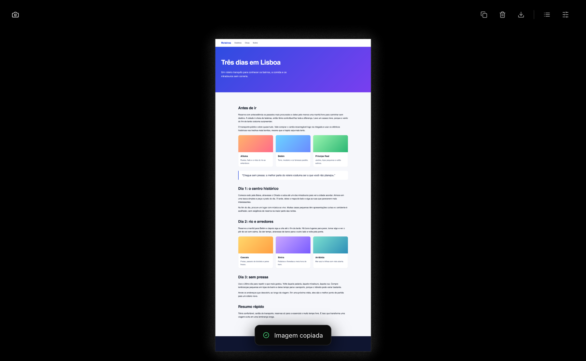
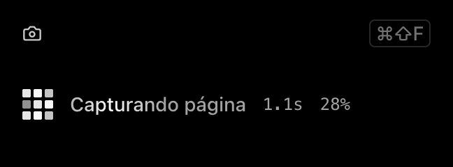
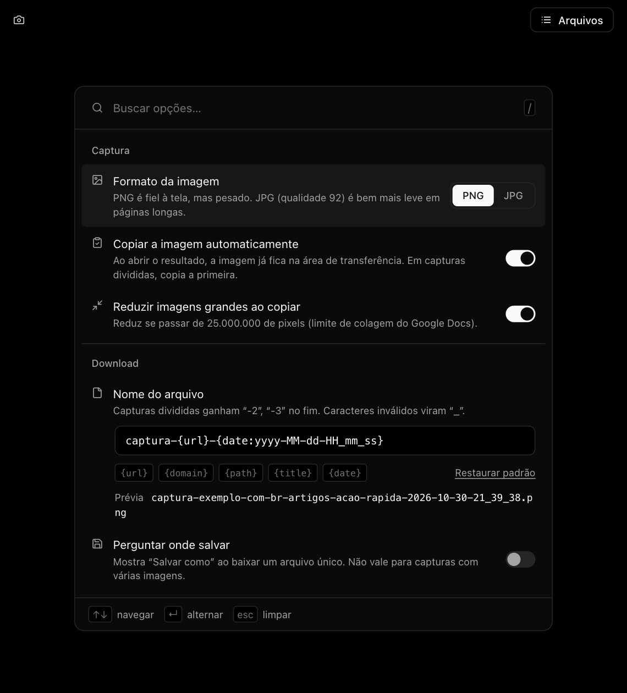

# Scrolling

Extensão para navegadores baseados em Chromium (Chrome, Edge, Brave, Arc, Dia e similares) que tira um print da **página inteira**, do topo ao fim, em um clique. Se a página for gigante, ela **divide a captura em várias imagens**. A imagem também vai **direto para a área de transferência**, pronta para colar.

Feita com Manifest V3 e JavaScript puro, sem build, sem dependências e **sem enviar nada para a internet**.

<p align="center">
  
</p>

## Sumário

- [O que ela faz](#o-que-ela-faz)
- [Requisitos](#requisitos)
- [Instalação passo a passo](#instalação-passo-a-passo)
  - [Opção A: baixar o zip (mais fácil)](#opção-a-baixar-o-zip-mais-fácil)
  - [Opção B: clonar com git](#opção-b-clonar-com-git)
  - [Fixar o ícone na barra](#fixar-o-ícone-na-barra)
- [Como usar](#como-usar)
- [Atalhos](#atalhos)
- [Opções](#opções)
- [Capturas muito grandes](#capturas-muito-grandes)
- [Atualizar para uma versão nova](#atualizar-para-uma-versão-nova)
- [Desinstalar](#desinstalar)
- [Privacidade e permissões](#privacidade-e-permissões)
- [Problemas comuns](#problemas-comuns)
- [Limitações conhecidas](#limitações-conhecidas)
- [Estrutura do projeto](#estrutura-do-projeto)
- [Licença](#licença)

## O que ela faz

- Captura a página inteira rolando e costurando as fatias, inclusive quando quem rola é uma área interna da página (e não a janela) ou quando o conteúdo está dentro de iframes.
- Prepara a página para um resultado limpo: desliga animações, carrega imagens preguiçosas (lazy-load), esconde barras de rolagem e evita que menus fixos e botões flutuantes se repitam em todas as fatias.
- Avisa quando a página é grande demais e divide em duas ou mais imagens, em vez de travar.
- Copia a imagem para a área de transferência automaticamente (e também por botão ou atalho).
- Guarda um histórico local das capturas na página "Arquivos", com seleção, exclusão e download em lote.
- Salva em PNG ou JPG, com nome de arquivo configurável.
- Tema preto em todas as telas.

## Requisitos

- Um navegador baseado em Chromium, versão **110 ou mais nova**.
- Nenhum programa extra. Para a Opção A basta o navegador. Para a Opção B você precisa do `git`.

## Instalação passo a passo

Essa extensão não está em uma loja. Você a instala em "modo desenvolvedor", que é um processo normal e leva menos de um minuto.

### Opção A: baixar o zip (mais fácil)

1. Abra a página de [Releases](../../releases/latest) deste repositório.
2. Em **Assets**, baixe o arquivo `scrolling-v1.0.0.zip` (o número pode ser mais novo).
3. Dê dois cliques no zip para descompactar. Vai aparecer uma pasta chamada `scrolling`.
4. **Mova essa pasta para um lugar onde ela vai ficar de vez**, por exemplo em Documentos. O navegador lê a extensão direto dessa pasta, então se você apagar ou mover a pasta depois, a extensão para de funcionar.
5. No navegador, abra a página de extensões:
   - Chrome, Brave, Arc: digite `chrome://extensions` na barra de endereço.
   - Edge: digite `edge://extensions`.
   - Dia: digite `dia://extensions`.
6. Ative o **Modo do desenvolvedor** (interruptor no canto superior direito da página).
7. Clique em **Carregar sem compactação** (em inglês: **Load unpacked**).
8. Escolha a pasta `scrolling` que você moveu no passo 4 e confirme.
9. O cartão "Scrolling" aparece na lista. Pronto, está instalada.

### Opção B: clonar com git

```bash
git clone https://github.com/cauecarneiro/scrolling.git
```

Depois siga os passos 5 a 9 acima, escolhendo a pasta `scrolling` criada pelo comando. Para atualizar no futuro, veja [Atualizar para uma versão nova](#atualizar-para-uma-versão-nova).

### Fixar o ícone na barra

Por padrão o navegador esconde o ícone de extensões novas.

1. Clique no ícone de peça de quebra-cabeça (extensões) na barra do navegador.
2. Ao lado de **Scrolling**, clique no alfinete para fixar.

O ícone da câmera passa a ficar sempre visível.

## Como usar

1. Abra a página que você quer capturar.
2. Clique no ícone da câmera, ou use o atalho `Command+Shift+F` (Mac) / `Ctrl+Shift+F` (Windows e Linux).
3. Um pequeno painel mostra o progresso ("Capturando página" e a porcentagem). **Não mexa na aba até terminar**, porque a página precisa ficar parada enquanto é fotografada. O navegador limita a velocidade de captura, então páginas longas levam alguns segundos.
4. Ao terminar, abre uma aba ao lado com o resultado e a imagem **já está copiada** na área de transferência. É só colar (`Command+V` ou `Ctrl+V`) onde quiser.

<p align="center">
  
</p>

Na tela de resultado:

- Clique na imagem para alternar entre "ajustada à tela" e tamanho real (100%).
- Botões no topo, da esquerda para a direita: **Copiar**, **Excluir**, **Baixar**, **Arquivos** (histórico) e **Opções**.
- Clique com o botão direito na imagem para salvar como, copiar cada imagem (em capturas divididas), copiar ou abrir a URL original.

A página **Arquivos** lista tudo que você já capturou. Dá para selecionar várias (segure Shift para marcar um intervalo), excluir e baixar em lote. Tudo fica guardado só no seu navegador.

## Atalhos

| Ação | Mac | Windows / Linux |
|---|---|---|
| Capturar a página inteira | `Command+Shift+F` | `Ctrl+Shift+F` |
| Copiar a imagem (na tela de resultado) | `Command+C` | `Ctrl+C` |
| Baixar | `Command+S` | `Ctrl+S` |
| Salvar como... | `Command+Shift+S` | `Ctrl+Shift+S` |
| Aproximar / afastar | `Command` e `+` / `-` | `Ctrl` e `+` / `-` |

**Mudar o atalho de captura:** abra a página de extensões do navegador, clique em **Atalhos de teclado** (menu à esquerda, ou direto em `chrome://extensions/shortcuts`, `edge://extensions/shortcuts` ou `dia://extensions/shortcuts`) e defina a combinação que preferir para "Scrolling". Se o atalho padrão já estiver em uso por outro programa ou extensão, ele pode não funcionar até você escolher outro.

## Opções

Abra pelo botão **Opções** na tela de resultado, ou clique com o botão direito no ícone da extensão e escolha **Opções**.

<p align="center">
  
</p>

| Opção | O que faz |
|---|---|
| Formato da imagem | **PNG** é fiel à tela, mas pesado. **JPG** (qualidade 92) é bem mais leve em páginas longas. |
| Copiar a imagem automaticamente | Ao abrir o resultado, a imagem já fica na área de transferência. Em capturas divididas, copia a primeira. |
| Reduzir imagens grandes ao copiar | Reduz a cópia se passar de 25.000.000 de pixels, que é o limite de colagem do Google Docs. O arquivo baixado continua no tamanho original. |
| Nome do arquivo | Modelo com as variáveis `{url}`, `{domain}`, `{path}`, `{title}` e `{date}`. Clique nas etiquetas para inserir e veja a prévia logo abaixo. Capturas divididas ganham `-2`, `-3` no fim. |
| Perguntar onde salvar | Mostra a janela "Salvar como" ao baixar uma imagem única. Não vale para capturas divididas. |

As opções salvam sozinhas, e aparece um "Salvo" no rodapé. Use `/` para buscar uma opção, as setas para navegar e `Enter` para ligar ou desligar.

## Capturas muito grandes

Navegadores têm um limite de tamanho para desenhar e salvar uma imagem. Quando a captura passa de **28.800 pixels** de altura ou largura, ou de **259,2 milhões de pixels** de área, a extensão avisa no painel ("Esta página será dividida em N imagens") e fatia o resultado em blocos de até 9.000 x 28.800 pixels.

- Na tela de resultado os blocos aparecem emendados, de cima para baixo.
- O download baixa todos: `nome.png`, `nome-2.png`, `nome-3.png` e assim por diante.
- A extensão codifica cada faixa assim que ela fica pronta e libera a memória, então não trava com páginas enormes.

Páginas com mais de 60.000 pixels de altura são cortadas nesse limite (a tela de resultado avisa).

## Atualizar para uma versão nova

- **Instalou pelo zip:** baixe o zip novo em [Releases](../../releases/latest), descompacte, substitua o conteúdo da pasta antiga pelo da nova (mantendo o mesmo caminho) e, em `chrome://extensions`, clique no ícone de recarregar no cartão do Scrolling.
- **Instalou com git:** dentro da pasta, rode `git pull` e depois clique no ícone de recarregar no cartão da extensão.

O histórico de capturas é mantido entre atualizações, desde que você não remova a extensão.

## Desinstalar

Na página de extensões, clique em **Remover** no cartão do Scrolling. Isso apaga também o histórico de capturas guardado pela extensão. Se quiser guardar alguma imagem, baixe antes. Depois pode apagar a pasta do disco.

## Privacidade e permissões

**Nada sai do seu computador.** A extensão não faz nenhuma requisição de rede, não tem servidor, não coleta estatísticas e não usa nenhum serviço externo. As capturas ficam no armazenamento local do navegador (IndexedDB) e as opções em `chrome.storage.local`.

Por que cada permissão é pedida:

| Permissão | Para quê |
|---|---|
| `activeTab` | Fotografar a aba que você está usando |
| `scripting` | Rolar a página e prepará-la para a captura |
| `tabs` | Ler URL e título da aba (usados no nome do arquivo e no histórico) e abrir a tela de resultado |
| Acesso a todos os sites (`<all_urls>`) | Entrar em iframes de outras origens para capturá-los por inteiro |
| `storage` | Guardar suas opções |
| `unlimitedStorage` | Guardar capturas grandes no histórico |
| `clipboardWrite` | Copiar a imagem para a área de transferência |
| `downloads` | Baixar as imagens |

O código é pequeno e está todo aqui, sem minificação. Você pode ler antes de instalar.

## Problemas comuns

**O atalho não faz nada.** Outro programa ou extensão pode estar usando a mesma combinação. Defina outro em "Atalhos de teclado" da página de extensões.

**O ícone não aparece na barra.** Fixe a extensão pelo ícone de peça de quebra-cabeça (veja [Fixar o ícone na barra](#fixar-o-ícone-na-barra)).

**Aparece "página restrita".** Por segurança o navegador não deixa extensões mexerem em páginas internas (`chrome://`, a loja de extensões, o leitor de PDF). Nesse caso o painel oferece capturar só a parte visível da aba.

**A página mudou de lugar ou ficou estranha durante a captura.** Foi só enquanto a extensão rolava. Ao terminar a posição original é restaurada. Se algo ficou diferente, recarregue a aba.

**Um menu ou botão flutuante aparece só no começo da imagem.** É proposital. Elementos fixos aparecem uma vez, na primeira fatia, e são escondidos nas demais para não se repetirem.

**Erro ao abrir o resultado (arquivo não encontrado) depois de atualizar.** O navegador manteve a versão antiga em memória. Na página de extensões, clique em recarregar no cartão do Scrolling. Se persistir, remova e carregue a pasta de novo.

**A captura demorou.** O navegador permite poucas capturas por segundo, então páginas muito longas levam mais tempo. Mantenha a aba aberta e em primeiro plano até terminar.

**A extensão sumiu depois de mover a pasta.** O navegador lê direto da pasta escolhida na instalação. Carregue a pasta de novo no novo local.

## Limitações conhecidas

- Não captura `chrome://`, a loja de extensões nem o leitor de PDF.
- Rolagem horizontal da página não é tratada.
- Iframes parcialmente fora da janela não são suportados.
- Páginas acima de 60.000 px de altura são cortadas.
- Ainda não tem exportação em PDF nem editor de anotações.

## Estrutura do projeto

```
scrolling/
  manifest.json        Configuração da extensão (Manifest V3)
  background.js        Orquestra a captura (service worker)
  content.js           Script injetado na página: mede, prepara, rola e restaura
  popup.*              Painel de progresso, avisos e erros
  capture.*            Tela de resultado e histórico (Arquivos)
  options.*            Página de opções
  ui.css               Tema preto e componentes base
  lib/
    tiles.js           Regra de divisão e escrita dos blocos
    db.js              Histórico (IndexedDB)
    options.js         Leitura e gravação das opções
    names.js           Modelo de nome de arquivo
    icons.js           Ícones em SVG
    loading-state.js   Animação de carregamento
  icons/               Ícones da extensão
  docs/images/         Imagens deste README
```

Não há build nem dependências: edite os arquivos, clique em recarregar no cartão da extensão e teste.

## Licença

[MIT](LICENSE)
